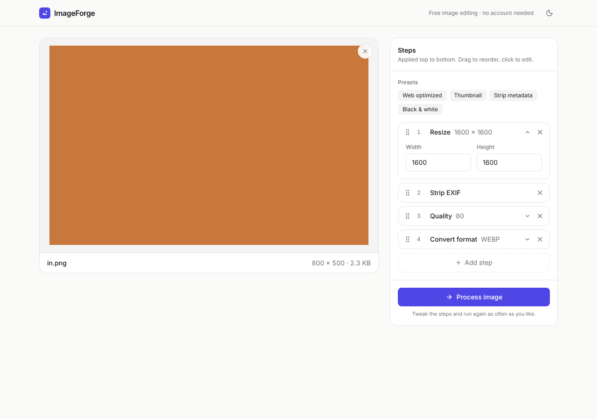
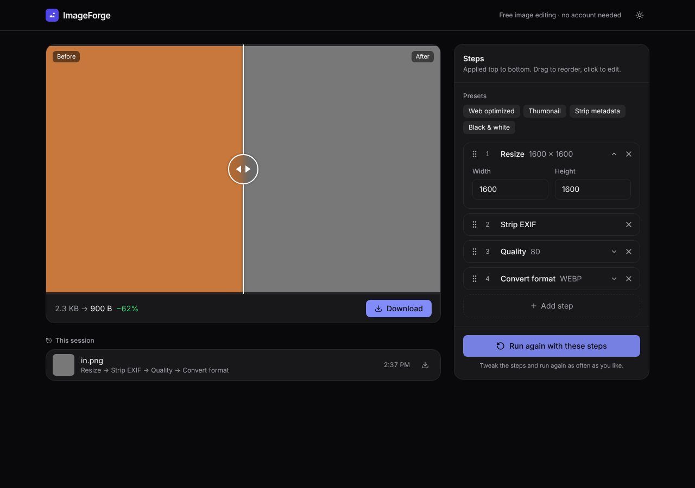
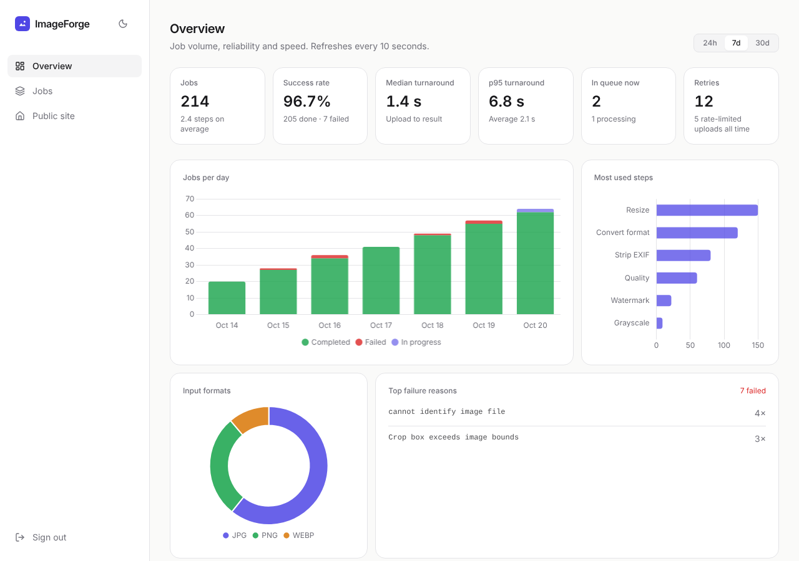
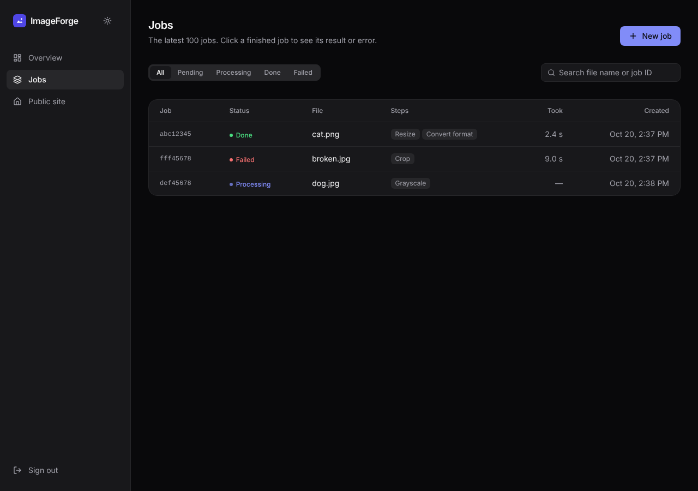
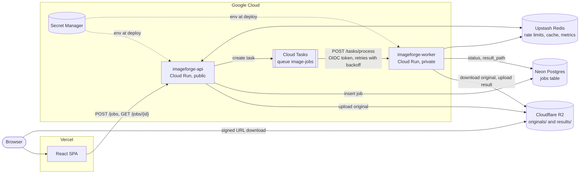
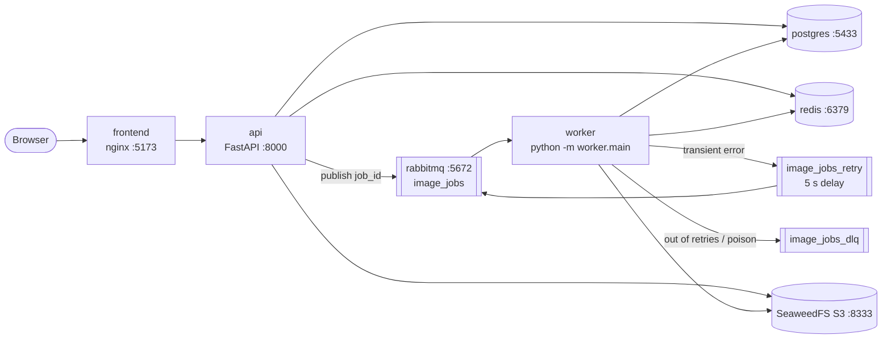

# ImageForge

ImageForge is an asynchronous image processing service. You upload an image with a list of steps (crop, resize, rotate, watermark, convert to WebP and so on), the API queues a job, a worker runs the steps with Pillow, and the browser picks up a signed download link when the job is done. An admin dashboard shows job analytics and the live queue.

It runs two ways from the same code:

- **In the cloud**, scaled to zero when idle: Cloud Run for the API and worker, Cloud Tasks as the queue, Neon Postgres, Upstash Redis, Cloudflare R2 for images and Vercel for the frontend.
- **Locally**, fully offline with `docker compose`: Postgres, Redis, RabbitMQ and SeaweedFS (an S3-compatible store).

| Upload and build steps | Result |
| --- | --- |
|  |  |
| **Admin analytics** | **Job queue** |
|  |  |

---

## Architecture

### Production (Google Cloud Run)



### Local (`docker compose`)



### How a job flows

1. `POST /jobs` validates the file (JPG, PNG or WebP, up to 10 MB) and the operation list, applies the per-IP rate limit in Redis, stores the original under `originals/` in the bucket, writes a `pending` row to Postgres and enqueues the job id.
2. The queue delivers the job id to a worker. `QUEUE_BACKEND` picks the queue: `rabbitmq` (the default, used locally) or `cloudtasks` (Cloud Run).
3. The worker marks the job `processing`, downloads the original, runs the steps in order, uploads the result under `results/` and marks the job `completed`. Deliveries are at-least-once, so a job that is already finished is skipped.
4. A transient error (storage or database hiccup) is retried with backoff up to `MAX_RETRIES` (default 3). With RabbitMQ the job goes through a 5 second delay queue, and after the last attempt to a dead-letter queue. With Cloud Tasks the worker answers 503 and Cloud Tasks redelivers; after the last attempt the job is marked `failed`. A bad image or invalid operation fails the job straight away.
5. The frontend polls `GET /jobs/{id}`. Once the job is done it gets a `result_url`, a short-lived signed URL straight to the bucket. Finished jobs are cached in Redis for an hour.

The code shares one job runner (`backend/worker/jobs.py`) between both worker entrypoints:

| Entrypoint | Used with | Command |
| --- | --- | --- |
| RabbitMQ consumer | local, `docker compose` | `python -m worker.main` |
| HTTP worker | Cloud Tasks on Cloud Run | `uvicorn worker.server:app --port 8080` |

---

## Tech stack

| Layer | Pieces |
| --- | --- |
| Frontend | React 19, Vite, Tailwind CSS, Chart.js, dnd-kit (drag to reorder steps), react-compare-slider (before/after), light and dark themes |
| API | FastAPI, Uvicorn, SQLAlchemy 2 (async) with asyncpg, Alembic migrations, JWT admin auth |
| Worker | Pillow, aio-pika (RabbitMQ) or a FastAPI HTTP endpoint (Cloud Tasks) |
| Data | PostgreSQL (job state), Redis (rate limits, job cache, counters), any S3-compatible bucket (images) |
| Cloud | Cloud Run, Cloud Tasks, Secret Manager, Artifact Registry, Cloud Build, Neon, Upstash, Cloudflare R2, Vercel |

---

## Image operations

`POST /jobs` takes the image as `file` and a JSON array of steps in the `operations` form field. Steps run in order, so they chain (crop, then resize, then watermark, then convert). The frontend offers the same steps plus presets (Web optimized, Thumbnail, Strip metadata, Black & white).

| `type` | Parameters |
|---|---|
| `resize` | `width`, `height` (1-10000) |
| `crop` | `left`, `top` (0-10000), `width`, `height` (1-10000). Fails the job if the box is outside the image. |
| `rotate` | `degrees` (-360 to 360, counter-clockwise), `expand` (default `true`, grows the canvas to fit) |
| `flip` | `direction`: `horizontal` or `vertical` |
| `grayscale` | none |
| `blur` | `radius` (default 2) |
| `sharpen` | `radius` (default 2), `percent` (strength, default 150) |
| `watermark` | `text`, `position` (`top_left`, `top_right`, `bottom_left`, `bottom_right`, `center`), `opacity` (0-1, default 0.5), `font_size` (default 24) |
| `quality` | `quality` (1-100) for JPEG/WebP output. PNG output is always lossless and optimized. |
| `strip_exif` | none. Without it, the original EXIF metadata is kept. |
| `format_convert` | `target_format`: `jpg`, `png` or `webp` |

Example:

```bash
curl -F file=@photo.jpg -F 'operations=[
  {"type": "crop", "left": 0, "top": 0, "width": 800, "height": 800},
  {"type": "resize", "width": 400, "height": 400},
  {"type": "watermark", "text": "© Me", "position": "bottom_right"},
  {"type": "strip_exif"},
  {"type": "quality", "quality": 80},
  {"type": "format_convert", "target_format": "webp"}
]' http://localhost:8000/jobs
# {"job_id": "…", "status": "pending"}

curl http://localhost:8000/jobs/<job_id>          # status, and result_url once completed
curl -L -o out.webp http://localhost:8000/jobs/<job_id>/download
```

## API

| Method and path | Auth | Purpose |
| --- | --- | --- |
| `GET /health` | none | Liveness check |
| `POST /jobs` | none, rate limited per IP | Upload an image with its steps; returns `202` and a `job_id` |
| `GET /jobs/{id}` | none | Job status, error message and `result_url` |
| `GET /jobs/{id}/download` | none | `307` redirect to the signed result URL |
| `POST /login` | none, lockout after repeated failures | Exchange `ADMIN_PASSWORD` for a bearer token |
| `GET /jobs?status=&limit=` | admin | Recent jobs, newest first |
| `GET /metrics` | admin | Running counters from Redis: queued, completed, failed, rate-limit hits, average processing time |
| `GET /stats?days=` | admin | Analytics over the last 1-90 days (see below) |

Interactive docs are at `/docs` on the API.

## Admin dashboard

Sign in at `/login` with `ADMIN_PASSWORD`. Admin requests send `Authorization: Bearer <token>`; tokens last `TOKEN_TTL_MINUTES`.

- **Overview** (`/admin`) reads `GET /stats` for 24 hours, 7 days or 30 days: total jobs, success rate, retries, average steps per job, turnaround (average, p50, p95), a completed/failed/in-progress timeline (hourly for 24 hours, daily otherwise), the most used operations, input formats and the top error messages. It aggregates straight from the `jobs` table, capped at 50,000 rows per request.
- **Queue** (`/admin/queue`) lists recent jobs with their status and links to the results.

---

## Run locally

### Option A: everything in Docker

```bash
export ADMIN_PASSWORD='pick-a-password'
export JWT_SECRET="$(python -c 'import secrets; print(secrets.token_urlsafe(48))')"
docker compose up -d --build
```

This starts Postgres, Redis, RabbitMQ, SeaweedFS, the API, the RabbitMQ worker and the frontend. The API applies Alembic migrations and creates the bucket on startup. Without `ADMIN_PASSWORD` and `JWT_SECRET` (in your shell or a root `.env`) admin login stays disabled.

| What | Where |
| --- | --- |
| Frontend | http://localhost:5173 (admin at `/login`) |
| API docs | http://localhost:8000/docs |
| RabbitMQ management | http://localhost:15672 (compose uses RabbitMQ's default local-only account) |
| S3 (SeaweedFS) | http://localhost:8333 |

Scale the workers with `docker compose up -d --scale worker=3`.

### Option B: infrastructure in Docker, app on your machine

```bash
docker compose up -d postgres redis rabbitmq s3

cd backend
python -m venv venv && source venv/bin/activate   # .\venv\Scripts\activate on Windows
pip install -r requirements.txt
cp .env.example .env   # then set ADMIN_PASSWORD and JWT_SECRET
alembic upgrade head
uvicorn api.main:app --reload --port 8000        # terminal 1
python -m worker.main                            # terminal 2

cd ../frontend && npm install && npm run dev     # terminal 3
```

### Tests

```bash
# No services needed
pip install -r backend/requirements.txt pytest httpx
pytest tests/test_operations.py tests/test_stats.py tests/unit

# Against a running stack (docker compose up)
ADMIN_PASSWORD=... python tests/smoke_test.py
pytest tests/e2e
```

---

## Deploy to the cloud

The full walkthrough is in **[deploy/cloudrun/README.md](deploy/cloudrun/README.md)**. In short:

1. Create the accounts: a Google Cloud project with billing, a [Neon](https://neon.tech) database, an [Upstash](https://upstash.com) Redis database, a [Cloudflare R2](https://developers.cloudflare.com/r2/) bucket with an API token, and a [Vercel](https://vercel.com) account.
2. Copy `deploy/cloudrun/config.example.env` to `deploy/cloudrun/config.env` (git-ignored) and fill it in. Paste Neon's connection string as it is; the pooled (`-pooler`) host is recommended, and the app adjusts asyncpg for it.
3. Run `./deploy/cloudrun/deploy.sh` (from a machine with the gcloud CLI, or Cloud Shell). It enables the APIs, creates the service accounts, stores every secret in Secret Manager, builds both images with Cloud Build (`deploy/cloudrun/cloudbuild.yaml`), creates the Cloud Tasks queue and deploys both services, then prints the API URL. Re-run it to ship a new version.
4. Import the repo in Vercel with **Root Directory** `frontend` and set `VITE_API_URL` to the API URL. Then put your Vercel domain in `CORS_ORIGINS` and re-run the deploy script.

What the script sets up:

| Piece | Setting |
| --- | --- |
| `imageforge-api` | Public, 1 vCPU, 512 MiB, 0-3 instances, `QUEUE_BACKEND=cloudtasks`, `TRUST_PROXY_HEADERS=true` |
| `imageforge-worker` | Private (only the `imageforge-tasks` service account may invoke it), 1 vCPU, 1 GiB, 0-3 instances, concurrency 4, 300 s timeout |
| `image-jobs` queue | `MAX_RETRIES + 1` attempts, 5-60 s backoff, at most 10 concurrent dispatches |
| Secrets | `DATABASE_URL`, `REDIS_URL`, `S3_ACCESS_KEY_ID`, `S3_SECRET_ACCESS_KEY`, `ADMIN_PASSWORD`, `JWT_SECRET` live in Secret Manager, never in plain env vars |

With no traffic every piece scales to zero, and the free tiers of all the services cover light use. Expect a cold start of a second or two after a quiet period.

---

## Configuration

### Services and storage

| Variable | Used by | Purpose |
| --- | --- | --- |
| `DATABASE_URL` | API, worker | Postgres URL. `postgres://`, `postgresql://` and `postgresql+asyncpg://` all work; `sslmode` and `channel_binding` from Neon are handled. |
| `DATABASE_POOLED` | API, worker | Force PgBouncer-safe settings on or off. By default they turn on for hosts containing `-pooler`. |
| `REDIS_URL` | API, worker | `redis://` locally, `rediss://` for Upstash |
| `QUEUE_BACKEND` | API | `rabbitmq` (default) or `cloudtasks` |
| `RABBITMQ_URL`, `QUEUE_NAME` | API, worker | Broker and queue for `QUEUE_BACKEND=rabbitmq` |
| `MAX_RETRIES` | worker | Attempts after the first for transient failures (default 3) |
| `GCP_PROJECT`, `GCP_LOCATION`, `CLOUD_TASKS_QUEUE` | API | Cloud Tasks queue for `QUEUE_BACKEND=cloudtasks` |
| `WORKER_URL`, `TASKS_SERVICE_ACCOUNT` | API | HTTP worker that Cloud Tasks calls, and the account that signs its OIDC token |
| `S3_BUCKET`, `S3_REGION` | API, worker | Bucket for originals and results (`S3_REGION=auto` for R2) |
| `S3_ENDPOINT_URL` | API, worker | Leave unset for AWS S3; set for R2, GCS, Spaces, MinIO or SeaweedFS |
| `S3_PUBLIC_ENDPOINT_URL` | API | Host put in signed URLs when browsers reach storage on a different host |
| `S3_ACCESS_KEY_ID`, `S3_SECRET_ACCESS_KEY` | API, worker | Storage credentials (omit to use the cloud's IAM role) |
| `S3_FORCE_PATH_STYLE` | API, worker | `true` for MinIO and SeaweedFS |
| `S3_URL_EXPIRY_SECONDS` | API | Lifetime of signed download URLs (default 3600) |
| `S3_CREATE_BUCKET` | API | Create the bucket on startup (local dev) |
| `MAX_FILE_SIZE_MB` | API | Upload size limit (default 10) |
| `RATE_LIMIT_PER_MINUTE` | API | Uploads per client IP per minute (default 10) |
| `RUN_MIGRATIONS` | API image | `false` to skip `alembic upgrade head` on startup |
| `VITE_API_URL` | frontend build | Public URL of the API, baked in at build time |

### Security

| Variable | Purpose |
| --- | --- |
| `ADMIN_PASSWORD` | Admin password. Login returns 503 until it is set. |
| `JWT_SECRET` | Key that signs admin tokens. If unset, a random key is used and tokens stop working on restart. |
| `TOKEN_TTL_MINUTES` | How long an admin token stays valid (default 60) |
| `LOGIN_MAX_ATTEMPTS`, `LOGIN_WINDOW_SECONDS` | Failed logins allowed per client IP within the window (default 5 per 15 minutes); after that `/login` returns 429 |
| `TRUST_PROXY_HEADERS` | `true` on Cloud Run or behind another proxy, so limits use the client IP from `X-Forwarded-For` (default `false`) |
| `CORS_ORIGINS` | Comma-separated browser origins allowed to call the API (default `http://localhost:5173`) |

Keep real values in `backend/.env`, a root `.env` or `deploy/cloudrun/config.env`, all git-ignored. Never commit them.

---

## Repository layout

```
backend/
  api/            FastAPI app: routes, schemas, auth, analytics (stats.py)
  worker/         processor.py (Pillow steps), jobs.py (shared runner),
                  main.py (RabbitMQ consumer), server.py (Cloud Tasks HTTP worker)
  shared/         database, models, S3 storage, queue backends
  migrations/     Alembic
frontend/         React SPA (Vite), vercel.json for Vercel
deploy/cloudrun/  deploy.sh, cloudbuild.yaml, config.example.env, walkthrough
infra/            SeaweedFS S3 config for local compose
tests/            unit, API, resilience and end-to-end tests
docker-compose.yml, Dockerfile.worker
```
